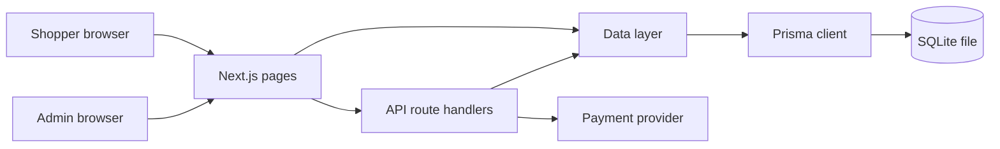

# Design: Online Shopping App

## Overview

An Amazon-like online store for one country, in English, with prices in US dollars. Shoppers browse, search and filter products, keep a cart and a wishlist, sign in with email and password, check out by card through a payment provider, and see their own orders. Store staff (Admins) manage products, orders and shoppers, and read the sales and stock reports, in an admin dashboard.

The app is one Next.js application: the storefront and the admin dashboard are React pages rendered by Next.js, and the API is Next.js route handlers in the same codebase. Data lives in a SQLite database file, read and written through Prisma. Card payments go through a payment provider in test mode, whose keys come from environment variables.

Release 1 covers Requirements 1 to 8 of `requirements.md`. The launch goals M1 and M2 are not features and are not built.

## Architecture

One Next.js app (App Router) with four layers:

- **Pages** (`app/`): server components that read data through the data layer and client components for the interactive parts (filters, cart, wishlist, checkout form, admin forms).
- **API route handlers** (`app/api/`): the JSON endpoints the client components call. Each handler checks the session and the role before it reads or writes.
- **Data layer** (`lib/`): Prisma client, queries and mutations grouped by record (products, carts, wishlists, orders, accounts, audit), and the rules that go with them (stock limits, hidden products, order status moves).
- **Database** (`prisma/`): the SQLite schema, the migrations and the seed script.

Sessions are signed, HTTP-only cookies holding the account id and role, set at sign-in and cleared at sign-out. Every API handler and every protected page reads the session first: a request with no session gets `401` from the API and the sign-in page from a page, with a `next` parameter so the person returns to where they were.

## Components and Interfaces

### Pages

| Path | Who | What it shows |
| --- | --- | --- |
| `/` | anyone | Product listings: 24 active in-stock products per page, search box, filters (category, min price, max price, sort), product cards with a heart |
| `/products/[id]` | anyone | Product page: image, name, price, description, category, stock status, Add to cart, heart |
| `/signin` | anyone | Sign-in form, link to register |
| `/register` | anyone | Registration form: name, email, password, delivery address |
| `/cart` | Shopper | Cart lines with quantity controls and Remove, cart total, Checkout button |
| `/wishlist` | Shopper | Saved products newest first, Add to cart and Remove |
| `/checkout` | Shopper | Delivery address, order lines, total, card form |
| `/orders` | Shopper | The shopper's orders newest first |
| `/orders/[id]` | Shopper | One order: lines, total, address, status |
| `/orders/[id]/confirmation` | Shopper | Order confirmation: order number and total |
| `/admin` | Admin | Dashboard: orders today, revenue today, active products, products with stock of 5 or fewer |
| `/admin/products` | Admin | Products list with search, create and edit forms, status control, delete |
| `/admin/orders` | Admin | All orders newest first, filter by status, status control |
| `/admin/shoppers` | Admin | Shopper accounts with name, email, registration date, order count |
| `/admin/reports` | Admin | Sales report (last 30 days) and stock report |

A Shopper who opens an `/admin` page gets the message "You do not have access to this page" (2.8). A person who is not signed in and opens `/cart`, `/wishlist`, `/checkout` or `/orders` gets the sign-in page and returns to that page after signing in (2.7).

### API route handlers

| Method and path | Who | Purpose |
| --- | --- | --- |
| `GET /api/products` | anyone | Listings: `q`, `category`, `minPrice`, `maxPrice`, `sort`, `page`; returns products and the total found |
| `GET /api/products/[id]` | anyone | One product, or `404` when hidden or out of stock |
| `POST /api/auth/register` | anyone | Create a Shopper account and sign in |
| `POST /api/auth/signin` | anyone | Sign in, return the role so the client opens the right page |
| `POST /api/auth/signout` | signed in | End the session |
| `GET /api/cart` | Shopper | The open cart with lines, availability and total |
| `POST /api/cart` | Shopper | Add one unit of a product, capped at stock |
| `PATCH /api/cart/[productId]` | Shopper | Set a line's quantity, capped at stock |
| `DELETE /api/cart/[productId]` | Shopper | Remove a line |
| `POST /api/cart/merge` | Shopper | Move the browser cart into the account's cart after sign-in |
| `GET /api/wishlist` | Shopper | Saved products newest first |
| `POST /api/wishlist` | Shopper | Save a product |
| `DELETE /api/wishlist/[productId]` | Shopper | Remove a saved product |
| `POST /api/checkout` | Shopper | Place the order: validate cart, charge the provider, place or refuse |
| `GET /api/orders` | Shopper | The shopper's orders newest first |
| `GET /api/orders/[id]` | Shopper | One order, only when it belongs to the shopper |
| `GET /api/admin/summary` | Admin | Dashboard figures |
| `GET /api/admin/products` | Admin | Products with `q` |
| `POST /api/admin/products` | Admin | Create a product as draft |
| `PATCH /api/admin/products/[id]` | Admin | Edit a product, change its status |
| `DELETE /api/admin/products/[id]` | Admin | Delete, or hide when the product is in a cart or an order |
| `GET /api/admin/orders` | Admin | All orders with `status` |
| `PATCH /api/admin/orders/[id]` | Admin | Change an order's status |
| `GET /api/admin/shoppers` | Admin | Shopper accounts with order counts |
| `GET /api/admin/reports` | Admin | Sales report and stock report |
| `GET /api/health` | anyone | Health path: `200` with `{"status":"ok"}` when the database answers |

Every handler returns JSON errors as `{"error": "<message>"}` with the status the page needs: `400` for a bad form, `401` for no session, `403` for the wrong role, `404` for a missing or foreign record, `409` for a conflict such as a duplicate email.

### Payment provider

`lib/payments.ts` wraps the provider in test mode. `charge(amountCents, card)` sends the amount and the card to the provider and returns `confirmed`, `declined` or `unavailable`. The provider's keys come from `PAYMENT_PROVIDER_KEY` and `PAYMENT_PROVIDER_SECRET`. The call has a 30-second timeout; a timeout or a provider error is `unavailable`. In tests and local runs, a card number ending in `0002` is declined and a provider key of `unavailable` makes the call fail, so both paths can be tried without the network.

## Data Models

Prisma models over SQLite. Money is stored in integer cents; dates are ISO timestamps.

- **Account**: `id`, `name`, `email` (unique), `passwordHash`, `address`, `role` (`shopper` or `admin`), `createdAt`.
- **Product**: `id`, `name`, `description`, `priceCents`, `stock`, `category`, `imageUrl`, `status` (`draft`, `active`, `hidden`), `createdAt`, `updatedAt`.
- **Cart**: `id`, `accountId` (unique, one open cart per shopper), `updatedAt`.
- **CartLine**: `id`, `cartId`, `productId`, `quantity`; unique on `(cartId, productId)`.
- **WishlistItem**: `id`, `accountId`, `productId`, `addedAt`; unique on `(accountId, productId)`.
- **Order**: `id`, `orderNumber` (unique, such as `ORD-20261101-0001`), `accountId`, `totalCents`, `paymentStatus` (`paid`), `status` (`placed`, `paid`, `shipped`, `delivered`, `cancelled`, `refunded`), `deliveryAddress`, `placedAt`.
- **OrderLine**: `id`, `orderId`, `productId`, `productName`, `unitPriceCents`, `quantity`; the name and price are copied so the order keeps what was bought.
- **AuditLog**: `id`, `actorId`, `actorName`, `action`, `entity` (`product` or `order`), `entityId`, `detail`, `createdAt`; kept for 2 years (8.6).

Indexes: `Product(status, category)`, `Product(name)`, `Order(accountId, placedAt)`, `Order(placedAt)`, `AuditLog(createdAt)`.

A cart left for more than 30 days is emptied when it is next read: `updatedAt` older than 30 days clears its lines.

## Error Handling

- **Form errors** are shown beside the field and in a message at the top of the form, with the exact text the requirements give ("An account with this email already exists", "Email or password is incorrect", "Only N left in stock", "This product is not available", "Your payment was declined. Your order was not placed.", "We could not confirm your payment. Your order was not placed.", "This product is in a cart or an order, so it was hidden instead of deleted", "You do not have access to this page", "Order not found", "No products found", "Your wishlist is empty", "You have no orders yet", "Your cart is empty").
- **Checkout** runs in one transaction: it re-reads each cart line's product, refuses when a line is hidden or out of stock (3.6), charges the provider, and only on `confirmed` writes the order, empties the cart and reduces stock. A decline or a timeout writes nothing, so the cart stays as it was (5.4, 5.5).
- **Stock** is reduced with a conditional update (`stock >= quantity`), so two shoppers buying the last unit cannot both succeed; the second gets the "Only N left in stock" message.
- **Unexpected errors** are logged with the request path and the account id, and the page shows "Something went wrong. Please try again." with a retry link.
- **Health path** returns `503` when the database does not answer, so the owner is alerted (8.4).

## Testing Strategy

- **Unit tests** (Vitest) for the data layer and the rules: stock caps, hidden products, cart totals, order status moves, the audit log, the sales and stock reports, and the payment wrapper with its confirmed, declined and unavailable paths.
- **API tests** (Vitest, calling the route handlers directly with a test session) for each endpoint's success and error status, including a shopper reading another shopper's order (`404`) and a shopper calling an admin endpoint (`403`).
- **Component tests** (Vitest with Testing Library) for the cart quantity control, the filters panel, the wishlist heart and the admin product form.
- **End-to-end journeys** (Playwright, in `e2e/`) for the flows a person walks: browse and search, add to cart and check out, save to the wishlist, and an admin editing a product and an order. They run only through `run_journeys`, against the running app.
- **Load check** for 8.1: a script sends 200 concurrent listings and search requests to a locally started server and asserts every answer is a success status.
- Each test starts its own SQLite database in a temporary folder, applies the migrations to it and points `DATABASE_URL` at it, so no test needs a database someone started.

## Build and run
Install: npm install
Test: npm test
Run locally: yes
Dev: npm run dev
Port variable: PORT
Health path: /api/health
Deploy: ssh-docker

`npm run dev` runs `prisma migrate deploy`, then the seed script (which seeds only an empty database and never in production), then `next dev` on `process.env.PORT`. `npm test` runs `vitest run` once and exits.

## Test logins

- Admin — `admin@shop.test` / `Admin1234`
- Shopper — `shopper@shop.test` / `Shopper1234`

The seed script creates these two accounts, about 500 active products across 8 categories, and three sample orders for the Shopper, only when the database has no account yet and `NODE_ENV` is not `production`. The live app gets its first Admin from `FIRST_ADMIN_EMAIL` and `FIRST_ADMIN_PASSWORD`, which `.env.example` names and which the app creates after the migrations when both are set and no account exists.

## Look and feel

A clean, modern storefront: white surfaces on a light grey page, one warm accent for the main actions, and generous spacing so product images lead.

- **Colours**: background `#f5f6f8`, surface `#ffffff`, text `#111827`, muted text `#6b7280`, primary `#c2410c` (hover `#9a3412`, pressed `#7c2d12`), border `#e5e7eb`, error `#b91c1c`, success `#15803d`, focus ring `#c2410c`.
- **Font**: `Inter, system-ui, -apple-system, "Segoe UI", sans-serif`; body 16px, line height 1.5; headings 600 weight, 20px to 32px.
- **Spacing**: a 4px scale (4, 8, 12, 16, 24, 32, 48); page padding 16px on a phone and 32px on a desktop, content at most 1280px wide and centred.
- **Corner radius**: 8px for cards, fields and buttons; 999px for the heart button and status pills.
- **Buttons**: primary filled in the primary colour with white text, 44px tall, 8px radius; secondary is a white button with a border; hover darkens, pressed darkens further, disabled is `#e5e7eb` with muted text and no pointer. Every button shows a 2px focus ring offset by 2px.
- **Fields**: white with a 1px border, 44px tall, 8px radius; focus shows the primary border and the focus ring; an invalid field shows the error border and its message below in the error colour.
- **Lists**: product cards on a white surface with a 1px border, a 4:3 image on top, name, category in muted text and price in 600 weight; hover lifts the card with a soft shadow. Tables in the admin use a white surface, a header row in muted uppercase 12px text and a 1px row divider.
- **Status pills**: paid and delivered in success green, shipped in primary, cancelled and refunded in error red, draft and hidden in muted grey.

### Screens

- **Product listings (`/`)**: on a phone, a sticky header with the store name, a search field and the cart and wishlist icons; a Filters button opens a full-height panel from the bottom with category, price range and sort, and an Apply button; below it a two-column grid of product cards, then pagination. On a desktop, the header holds the search field in the middle; a 240px filter column sits on the left and the grid shows four cards per row.
- **Product page**: on a phone, the image full width on top, then name, price, stock status, the Add to cart button and the heart, then the description; on a desktop, the image on the left half and the details on the right, with the Add to cart button under the price.
- **Sign-in and register**: a centred card at most 420px wide on both sizes, with the fields stacked, the primary button full width and the link to the other form below.
- **Cart**: on a phone, one line per product with a small image, name, price, a quantity stepper and Remove, and a sticky bar at the bottom with the total and the Checkout button; on a desktop, the lines in a wide column and a summary card on the right with the total and Checkout.
- **Wishlist**: the same card grid as the listings, each card with Add to cart and Remove under the price.
- **Checkout**: on a phone, the address, the order lines and the card form stacked, with the total and Pay button in a sticky bar; on a desktop, the form on the left and an order summary card on the right.
- **Orders and order detail**: a list of cards on a phone and a table on a desktop, each row opening the order; the detail shows the lines, total, address and a status pill.
- **Admin dashboard**: on a phone, four figure cards stacked and a menu of the admin pages; on a desktop, a left sidebar with the admin pages and a row of four figure cards above the content.
- **Admin products, orders and shoppers**: a search or filter bar above a table on a desktop and a list of cards on a phone; the product form opens in a panel on the right on a desktop and full screen on a phone.
- **Admin reports**: the sales report as a table of the last 30 days with a small bar chart of daily revenue, and the stock report as a table of low-stock products, stacked on a phone.

## Assumptions

- The payment provider is a test-mode provider reached through `lib/payments.ts`, with a card ending in `0002` declined and a provider key of `unavailable` failing the call, so checkout can be tried locally and in tests without a live merchant account.
- The seed script creates about 500 active products across 8 categories, so the listings, search and filters have data to show.
- The admin dashboard's sales report covers the last 30 days, and its stock report lists products with stock of 5 or fewer, as `requirements.md` assumes.
- The deploy target is a cloud app host with a managed disk for SQLite, reached over SSH with Docker (`ssh-docker`), so the SQLite file lives on the persistent disk.
